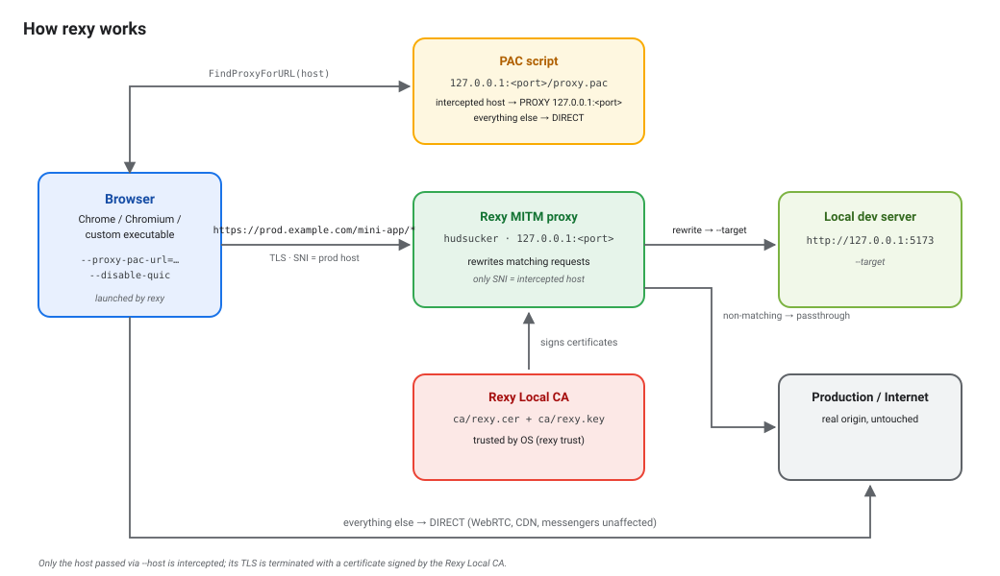

# rexy

`rexy` launches a browser through a local man-in-the-middle (MITM) proxy. The proxy
intercepts traffic to one live site (e.g. `example.com`) and serves requests under a
chosen path prefix from your local dev server — everything else reaches the live site
untouched. No `/etc/hosts`, no DNS tricks, no self-signed certificates on your dev
server.

You give `rexy` three things: the domain of a live site, a path prefix, and your dev
server URL. It starts the local proxy, generates a PAC file that routes only that domain
through it, and launches Chrome (or Chromium, or any browser executable). Then you just
browse the site as usual — the matching pages are transparently served from your local
build.



## How it works

1. `./generate_ca.sh` generates a local certificate authority (one-time setup) in
   `ca/` — `rexy.cer` (the certificate) and `rexy.key` (its private key).
2. `rexy trust` installs that CA into your OS trust store, so the browser accepts the
   certificates the proxy issues on the fly.
3. On `rexy run`, the tool:
   - starts a [hudsucker](https://crates.io/crates/hudsucker) MITM proxy on
     `127.0.0.1` (a free port by default),
   - serves a PAC script that routes **only** the intercepted host (and its
     subdomains) through the proxy — everything else goes `DIRECT`, so messengers,
     WebRTC/STUN, long-poll and CDNs are unaffected,
   - launches the browser with `--proxy-pac-url=...` and `--disable-quic`,
   - rewrites matching requests: `https://<host><path>*` → `<target>` (matching uses the `host` header, falling back to the request URI authority so HTTP/2 requests, which have no `host` header, are matched too).
4. TLS interception is restricted to the intercepted host only.

Ctrl+C stops the browser and the proxy.

## Requirements

- OpenSSL (for `generate_ca.sh`)
- A Chromium-based browser (Chrome / Chromium / any executable path)

Supported platforms: **macOS**, **Windows**, **Linux**.

## Install

### Quick Install (recommended)

You can install `rexy` with a single command using the installer script.

**Linux / macOS:**
```bash
curl --proto '=https' --tlsv1.2 -LsSf https://github.com/sumbad/rexy/releases/latest/download/rexy-installer.sh | sh
```

**Windows:**
```bash
powershell -ExecutionPolicy Bypass -c "[Net.ServicePointManager]::SecurityProtocol = [Net.SecurityProtocolType]::Tls12; irm https://github.com/sumbad/rexy/releases/latest/download/rexy-installer.ps1 | iex"
```

### Manual Installation

Alternatively, you can install `rexy` by downloading a pre-compiled binary from the [**Releases page**](https://github.com/sumbad/rexy/releases).

1.  Download the appropriate archive for your system.
2.  Unpack the archive.
3.  Move the `kley` binary to a directory in your system's `PATH` (e.g., `/usr/local/bin` on macOS/Linux).

### Install via npm (Node.js)
If you have Node.js installed, you can install `rexy` directly from npm:

```bash
npm install -g rexy-cli
```

### Install via Cargo (crates.io)
If you have Rust and Cargo installed, you can install `rexy` directly from crates.io:

```bash
cargo install --locked rexy
```

Or build from source:

```sh
cargo install --path .
```

## Setup

```sh
# 1. Generate the local CA (one-time; creates ca/rexy.cer and ca/rexy.key)
./generate_ca.sh

# 2. Install the CA into the OS trust store
rexy trust
```

- **macOS** — installs into the login keychain via `security` (`trustRoot`, SSL policy)
- **Windows** — installs into the current-user `Root` store via `certutil`
- **Linux** — copies the certificate to
  `/usr/local/share/ca-certificates/local-dev-proxy.crt` and runs
  `update-ca-certificates` (via `pkexec`)

`rexy trust` is idempotent: re-running it after regenerating the CA replaces the old certificate. `rexy clean` removes the CA from the trust store.

## Usage

Single rule via flags:

```
rexy run --host <host> --path <path> --target <url> -- <browser args>
```

Example serves an url from a local Vite dev server:

```sh
rexy run \
  --browser chrome \
  --host example.com \
  --path /app/ \
  --target http://127.0.0.1:5173 \
  -- --new-window https://example.com/app/foo
```

If the target server sends a restrictive `Content-Security-Policy` that breaks the proxied page (e.g. `frame-ancestors` blocks embedding it in a parent shell), override the header for responses served from the target:

```sh
rexy run \
  --browser chrome \
  --host example.com \
  --path / \
  --target https://dev.example.internal \
  --csp-override "frame-ancestors *" \
  -- --new-window https://app.example.com/
```

`--csp-override off` removes the header entirely. Only responses actually redirected to `--target` are affected; production passthrough traffic and `Content-Security-Policy-Report-Only` are never modified.

### Running an Electron app as the browser

`--browser` accepts any executable, including an Electron app — the typical superapp workflow is
to run the local shell through rexy instead of a plain browser:

```sh
rexy run   --browser /path/to/my-electron-app   --file rules.toml   -- --user-data-dir=/tmp/rexy-electron-profile --remote-debugging-port=9222      /path/to/my-electron-app --some-app-flag
```

- Everything after `--` is passed to the launched executable **as is** — rexy does not interpret
  it. That passthrough is what lets you give the Electron app its own arguments (app path,
  app flags, profile).
- The proxy settings (PAC URL and `--disable-quic`) are added by rexy itself; the app does not
  need to know about the proxy. The PAC-based routing works for Electron exactly like for
  Chrome, because Electron is Chromium.
- The CDP (remote debugging) port is an Electron/Chromium argument passed after `--`
  (`--remote-debugging-port=9222`), not a rexy option — rexy never talks to it itself, tools
  like `dev-workspace` connect to `127.0.0.1:9222` directly.
- A separate `--user-data-dir` is recommended: Chrome ≥136 does not enable remote debugging on
  the default profile, and an isolated profile keeps the session independent of your daily
  browser.

### Multiple rules via a config file

Pass `--file`/`-f` with a TOML file to intercept several hosts with one browser:

```toml
# rules.toml
[[rules]]
host = "app.example.com"
path = "/"
target = "https://dev-app.example.internal"
csp_override = "frame-ancestors *"   # optional; "off" removes the header

[[rules]]
host = "other.example.com"
target = "http://127.0.0.1:3000"
```

```sh
rexy run -f rules.toml
```

- `--file` cannot be combined with `--host`, `--path`, `--target` or `--csp-override` — those configure a single rule.
- `--browser`, `--proxy-port` and browser arguments after `--` stay on the command line.
- The first matching rule wins (host + path prefix).
- `intercept = false` (default `true`) turns the rule's host into a TLS passthrough: the PAC still routes it through the proxy, but the CONNECT is tunneled **without decryption** — no rewritten certificate, no redirects, only a CONNECT line in the logs (like `--ignore-hosts` in mitmproxy). This is the escape hatch for pinned clients and MITM-unfriendly WAFs; because the traffic is never decrypted, a `target` on such a rule is never used.
- An empty `rules` list is allowed: rexy logs a warning and runs without redirects.

### Hot reload of the rules file

In `--file` mode rexy watches `rules.toml` and applies edits without restarting the proxy or the
browser — the browser session (logins, profiles) survives. Changes are picked up within about a
second:

- The rule set is swapped atomically; in-flight requests are unaffected.
- The PAC script is regenerated when the set of hosts changes. Note: the browser re-fetches the
  PAC on its own schedule (network-change events), so routes for *new* hosts start working after
  the next PAC fetch; edits to paths/targets of already-intercepted hosts apply immediately.
- A broken file (bad TOML, validation error) never kills the proxy: rexy logs a warning and keeps
  the previous rule set until a valid version is saved.
- Single-rule mode (`--host/--path/--target`) has no file to watch — restart to change it.

### Commands

| Command                  | Description                                                       |
| ------------------------ | ----------------------------------------------------------------- |
| `rexy run`               | Launch the browser through the local proxy                        |
| `rexy trust`             | Install the Rexy Local CA into the OS trust store                 |
| `rexy trust --firefox`   | Install the CA into Firefox profiles (NSS, via `certutil`)        |
| `rexy clean`             | Remove the Rexy Local CA from the OS trust store                  |
| `rexy clean --firefox`   | Remove the CA from Firefox profiles                               |
| `rexy rules check`       | Print which rule would match each URL (offline, same matcher)     |

### `run` options

| Option                     | Default    | Description                                                        |
| -------------------------- | ---------- | ------------------------------------------------------------------ |
| `--browser <name or path>` | `chrome`   | `chrome`, `chromium`, or a path to a browser executable            |
| `--file <path>` (`-f`)     | —          | TOML file with `[[rules]]`; excludes `--host/--path/--target/--csp-override` |
| `--host <host>`            | —          | Production hostname to intercept (hostname only, no path/scheme)   |
| `--path <prefix>`          | `/`        | Production path prefix to redirect (must start with `/`)           |
| `--target <url>`           | —          | Local development server (`http://` or `https://`)                 |
| `--proxy-port <port>`      | `0`        | Local proxy port; `0` picks a free port                            |
| `--csp-override <policy\|off>` | —      | Replace all `Content-Security-Policy` headers of responses served from `--target` (`off` removes them); passthrough traffic is untouched |
| `-- <args>`                | —          | Extra arguments passed to the browser                              |

### HTTP/2

Rexy speaks HTTP/2 end-to-end for intercepted hosts: the browser connects to the proxy over h2 and
the proxy negotiates h2 with the upstream via ALPN whenever the target supports it — multiplexing
and long-poll behave like they do on prod. This matters for matching too: HTTP/2 requests carry
the authority in the `:authority` pseudo-header instead of a `host` header, which is why rule
matching falls back to the request URI host.

HTTP/3/QUIC stays off: the browser is launched with `--disable-quic`, so all traffic remains
TCP-based and interceptable.

### Firefox support

```sh
rexy trust --firefox        # CA into every Firefox profile (NSS, via certutil)
rexy run --browser firefox -f rules.toml
```

- Firefox has no proxy command-line flags, so `rexy run --browser firefox` creates a **throwaway
  profile** (`$TMPDIR/rexy-firefox-profile-<pid>/`) with prefs pointing at the PAC URL and
  disabling HTTP/3 — the Firefox equivalent of `--proxy-pac-url` + `--disable-quic`. The profile
  is fresh every run: no stored session, exactly the isolation you want for a dev proxy.
- The CA must be in the NSS store of the profile (`rexy trust --firefox` puts it into all
  profiles); without `certutil` on PATH rexy prints the install hint instead of failing silently.
- The OS trust store is not involved for Firefox: `rexy run --browser firefox` does not require
  `rexy trust` to have run.
- Verified on macOS; on Linux/Windows the flow is the same (`~/.mozilla/firefox` and
  `%APPDATA%\Mozilla\Firefox` `profiles.ini`), with NSS tools installed per your distro.
- HTTP/3/QUIC stays off by pref; enterprise policies and custom `certutil` locations are out of
  scope.

### Logging

Logging is controlled by `RUST_LOG` (via `tracing-subscriber`), e.g.:

```sh
RUST_LOG=debug rexy run ...
```

### Environment variables

| Variable       | Default | Description                                                                                       |
| -------------- | ------- | ------------------------------------------------------------------------------------------------- |
| `RUST_LOG`     | —       | `tracing` log filter (see [Logging](#logging))                                                      |
| `REXY_PAC_ALL` | unset   | When `1`, the PAC routes **every** host through the proxy (not just intercepted ones). Diagnostic escape hatch: it defeats the `DIRECT` optimization so traffic the browser would otherwise keep on a direct connection (e.g. HTTP/2 long-polls) becomes interceptable. WebRTC/media may break while it is on. |

## Security notes

- `ca/rexy.key` is the private key of your local CA. It never leaves your machine and must **never** be committed.
- The CA is scoped to this machine's development use. Regenerate it if it may have leaked, then re-run `rexy trust`.
- Only traffic to the hosts you explicitly configure (via `--host` or rules in `--file`) is intercepted and decrypted.

## License

Licensed under the [MIT License](LICENSE).
